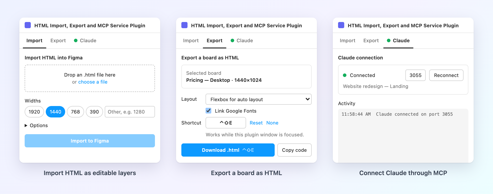
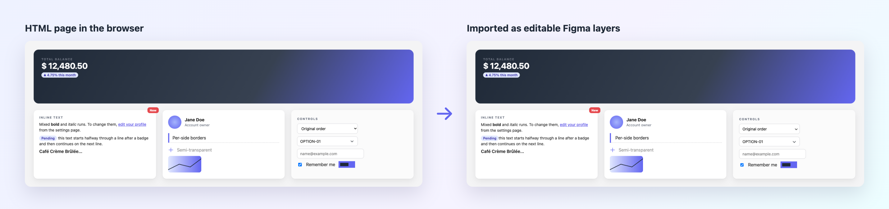

# HTML Import, Export and MCP Service Plugin for Figma

**A free, open-source Figma plugin for unlimited HTML → Figma imports and unlimited Figma → HTML
exports.** No account, no API key, no AI, no limits. Everything runs on your own computer, inside
your own Figma.

## Why this plugin

| | |
| --- | --- |
| ✅ **Unlimited imports** | Turn as many HTML pages into Figma layers as you want. No monthly cap, no credits. |
| ✅ **Unlimited exports** | Export any board to a clean HTML file, as often as you want. |
| ✅ **100% free** | No trial, no paid plan, no "pro" features held back. MIT license, commercial use included. |
| ✅ **No account, no API key** | Install it and use it. Nothing to sign up for, nothing to paste in. |
| ✅ **No AI required** | Import and Export are plain, predictable converters. AI is an optional extra, off by default. |
| ✅ **Works with any AI, if you want** | Optional MCP connection for Claude, Cursor, VS Code, Windsurf, Gemini, Codex and other MCP apps. |
| ✅ **Private by design** | Your designs and HTML files are processed locally in Figma and are never uploaded anywhere. |
| ✅ **Open source** | Read every line, change it, and build your own version. |

## Everything stays on your computer

- **Import** renders your HTML inside the plugin window in Figma on your machine and converts it to
  layers right there.
- **Export** builds the HTML file inside Figma and saves it straight to your computer.
- The plugin has **no server, no tracking and no analytics**. The only internet access is to load
  images and fonts that your own HTML page links to, exactly as a browser would.

## What it does

### Import HTML into Figma

- Real, **editable layers**: frames, text, vectors and images, not a flat screenshot
- Several **screen widths at once** (1920, 1440, 768, 390 or any custom width), each as its own frame
- Text keeps its styles: bold, italic, links, colors, sizes, line height, letter spacing, truncation
- Gradients, shadows, blurs, borders, rounded corners, opacity and clipping
- Inline SVG icons become **editable vectors**; images, `<picture>`, CSS backgrounds and `object-fit` work
- Form fields, canvas and video frames are included
- Options: light or dark appearance, import only one element (CSS selector), full page height, and
  whether to run the page's scripts

### Export boards as HTML

- **Export many boards at once**: select several frames and get one `.zip` with an `.html` file for each
- One **self-contained `.html` file** per board: images embedded, icons as inline SVG, nothing else to ship
- **Auto layout becomes flexbox**, or choose fixed positions for a pixel-exact copy
- **Readable CSS** with class names taken from your layer names
- Gradients, shadows, blurs, strokes, corner radius and text styles carried over
- Google Fonts linked automatically for the fonts you used
- **Download .html** or **Copy code**, with a keyboard shortcut you can change

## Install (no command line)

1. Download **`figma-plugin.zip`** from the
   [latest release](https://github.com/jgptrd/figma-html-import-export-mcp/releases/latest)
   and unzip it.
2. Open **Figma Desktop** and any design file. (The browser version of Figma can't load plugins from
   a file.)
3. Go to **Plugins → Development → Import plugin from manifest…** and choose `manifest.json` inside
   the unzipped `figma-plugin` folder.

That's it. Run it any time from **Plugins → Development → HTML Import, Export and MCP Service Plugin**.
Keep the unzipped folder where it is, because Figma loads the plugin from it.

## How to use it

**Import:** open the **Import** tab, drop an `.html` file on the window (or click **choose a file**),
pick one or more widths, and click **Import to Figma**. Each width becomes its own frame next to your
existing work.

> Tip: a single self-contained HTML file works best, for example a page saved with the free
> [SingleFile](https://github.com/gildas-lormeau/SingleFile) browser extension. Pages saved as
> "HTML + folder of files" lose their local images and styles.

**Export:** select one or more frames, open the **Export** tab, and click **Download .html** (or
**Copy code** for a single board). With several boards selected you get one `.zip` with an `.html`
file for each board.

- Shortcut: **⌃⇧E** on Mac, **Alt+Shift+E** on Windows, while the plugin window is focused. Click
  the **Shortcut** box to set your own keys; the plugin warns you if Figma already uses them.
- **Plugins → Development → HTML Import, Export and MCP Service Plugin → Export selection as HTML**
  downloads the selected board in one step. After that, Figma's **Run last plugin** (**⌥⌘P**,
  Ctrl+Alt+P on Windows) repeats it from anywhere.

## Bonus: work with any AI app (optional, off by default)

If you want, an AI assistant can work in Figma for you: import pages, build layouts, edit layers
and export boards. It works with **any AI app that supports MCP**: Claude, Cursor, VS Code (GitHub
Copilot), Windsurf, Gemini CLI, Codex CLI and more.

It is **off by default** and completely optional. Turn it on in the plugin under **Settings (gear
icon) → Connect to an AI assistant (MCP)**; only then does the **AI** tab appear. While it is off,
the plugin doesn't connect to any MCP server.

Setup for each app and the list of tools: **[docs/ai-mcp.md](docs/ai-mcp.md)**.

## Good to know

- Imports use fixed positions (flexbox in the HTML isn't turned into auto layout yet), CSS
  `::before`/`::after` decorations are skipped, and CSS transforms are flattened.
- Figma can only use fonts installed on your computer. Missing fonts fall back to Inter and the
  plugin tells you which ones were replaced.
- Importing straight from a website URL needs the optional AI setup, because most sites don't
  allow other pages to download their HTML.

## How it was built

This plugin was built with AI assistance ([Claude Code](https://claude.com/claude-code)), with the
features, design decisions and testing in Figma done by a person. All the code is here to
read, along with automated tests you can run with `npm test`.

## Contributing

Ideas, bug reports and pull requests are welcome. See **[docs/development.md](docs/development.md)**
for how to build and test.

## License

[MIT](LICENSE): free to use, modify and share, including for commercial work.

This is an independent community project, not affiliated with or endorsed by Figma or Anthropic.
"Figma" and "Claude" are trademarks of their respective owners.
